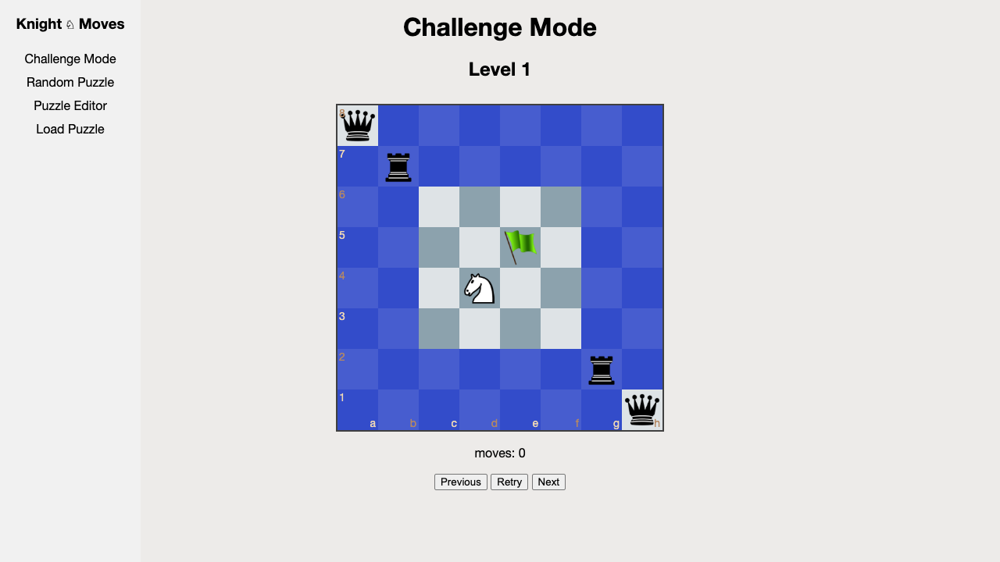
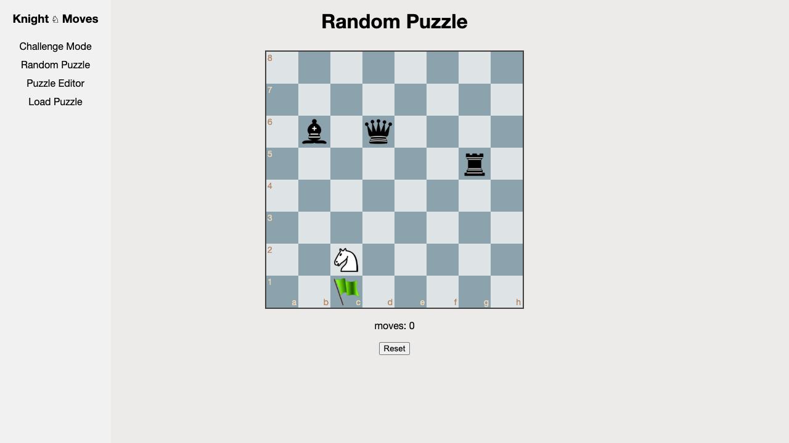
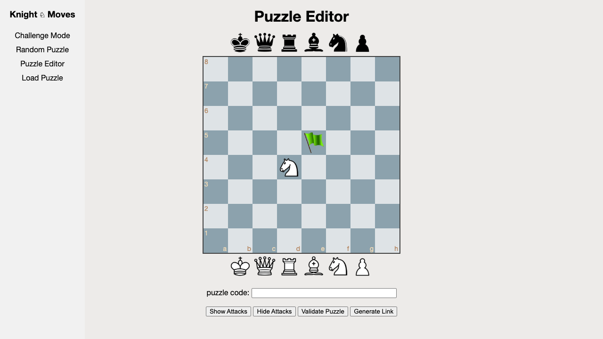

# Knight Moves

A chess puzzle game where you navigate a knight to the green flag without being captured by enemy pieces.

**[Play it here](https://cogan.github.io/chessknightmoves/)**

## How to Play

Click to move your knight (white) across the board. Enemy pieces (black) guard certain squares — if you land on or pass through an attacked square, you lose. Reach the green flag to win.

## Game Modes

### Challenge Mode

Work through a series of pre-built puzzles with increasing difficulty. Use the Previous/Next buttons to navigate between levels.

### Random Puzzle

Play a randomly generated puzzle. Every random puzzle is guaranteed to have at least one solution. Hit Reset to generate a new one.

### Puzzle Editor

Design your own puzzles. Drag pieces from the piece tray onto the board, position the knight and flag, then use **Validate Puzzle** to confirm it's solvable. **Generate Link** creates a shareable URL so others can play your creation.

### Load Puzzle

Paste a puzzle code from the editor to load and play a custom puzzle.

## Built With

JavaScript and [chessboard.js](https://chessboardjs.com/). Hosted on GitHub Pages.
